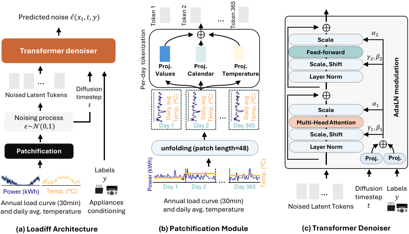
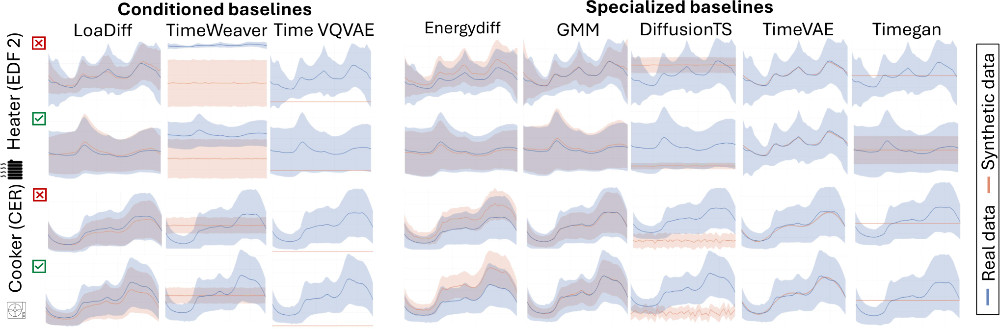

# LoaDiff ⚡

<div align="center">

[](https://arxiv.org/abs/2609.11639)
[](https://arxiv.org/abs/2609.11639)
[](pyproject.toml)
[](pyproject.toml)

**Year-long smart-meter load curves, conditioned on household attributes and weather.**

[Paper](https://arxiv.org/abs/2609.11639) · [Dataset](https://doi.org/10.5281/zenodo.22257867) · [Getting started](#getting-started-) · [Data](#data-) · [Generate samples](#generate-load-curves-) · [Citation](#citing-loadiff-)

</div>

Official PyTorch implementation of **LoaDiff: Conditional Generation of Electricity Consumption Time Series for Energy Analytics**, published at **IEEE ICDM 2026**.

📊 **Companion dataset:** [LoaDiff-CER](https://doi.org/10.5281/zenodo.22257867) — **50,000 synthetic yearly residential load curves**, released with the paper.

Smart-meter data enable load forecasting, appliance detection, and demand-side flexibility analysis, but access to individual household records is restricted. **LoaDiff** learns to generate realistic electricity-consumption time series over an entire year, with control over **appliance ownership**, **calendar information**, and **outdoor temperature**.

<p align="center">
  <picture>
    <source media="(max-width: 700px)" srcset="assets/overview-mobile.svg">
    
  </picture>
</p>

The model combines **denoising diffusion** with a **Diffusion Transformer (DiT)** adapted to long time series. At 30-minute resolution, a year contains **17,520 measurements**. LoaDiff represents each day as one token, allowing the Transformer to model seasonal behavior while retaining the daily structure of electricity consumption.

## Outline 📝

This project provides:

- **LoaDiff training and inference**, with unconditional, dataset-conditioned, and user-conditioned generation.
- **A released synthetic dataset**, [LoaDiff-CER](https://doi.org/10.5281/zenodo.22257867), for energy analytics and appliance-detection research.
- **Generative baselines**: TimeGAN, TimeVAE, Diffusion-TS, and a convolutional U-Net.
- **Evaluation tools** for fidelity, diversity, memorization risk, and downstream appliance detection with ROCKET and TransApp.
- **Post-processing tools** for physical checks, repairs, and calibrated plausibility filtering of generated curves.

## Getting Started 🚀

Use **Python 3.12 or newer** and [uv](https://docs.astral.sh/uv/) to install the project dependencies:

```bash
pip install uv
git clone https://github.com/adrienpetralia/loadiff.git
cd loadiff
uv sync
```

**Dependency access:** `pyproject.toml` currently installs `privacyeval` from an EDF-hosted GitLab repository. Installing the complete environment requires access to that repository.

**Hardware:** the training entry point requires a CUDA GPU. Inference supports CUDA and CPU; use `inference.device=cpu` for CPU sampling.

Run the commands below from the repository root, after preparing the data described in the next section. Training produces the checkpoints used for inference; pretrained weights are not bundled in this checkout. The released synthetic dataset is hosted on Zenodo, as described below.

## Data 📊

### Released dataset: LoaDiff-CER

**[LoaDiff-CER: 50,000 Synthetic Residential Electricity Load Curves Conditioned on Appliance Ownership](https://doi.org/10.5281/zenodo.22257867)** is the companion dataset released with our ICDM paper.

It contains **50,000 fully synthetic year-long load curves**, each with **17,520 measurements at 30-minute resolution**, expressed in **watts**. The curves are generated by LoaDiff and conditioned on four appliance-ownership attributes derived from CER: **cooker**, **dishwasher**, **tumble dryer**, and **water heater**.

The release includes:

- `loadiff_cer_synthetic.parquet` — the synthetic consumption time series (approximately **3.15 GB**).
- `metadata.csv` — the associated appliance-ownership metadata.

**[Download on Zenodo](https://doi.org/10.5281/zenodo.22257867)** · **[NLM Dataset Catalog record](https://datasetcatalog.nlm.nih.gov/dataset?q=0003278545)** · **[CC BY 4.0 license](https://creativecommons.org/licenses/by/4.0/)**

All released curves are model-generated; the original CER measurements are not redistributed. You can use this dataset to work with LoaDiff-generated curves without training a generator yourself.

### Evaluation datasets

The paper evaluates LoaDiff on **three datasets**, all at 30-minute resolution:

| Dataset | Description | Access |
| --- | --- | --- |
| **CER** | Irish smart-meter data; 4,225 residential households in the paper's experimental subset. | Available through [ISSDA](https://www.ucd.ie/issda/data/commissionforenergyregulationcer/), subject to its access conditions. |
| **EDF 1** | Real smart-meter data from 2,083 households, with appliance-ownership information. | Proprietary EDF data; not distributed here. |
| **EDF 2 (SMACH)** | 20,000 synthetic household profiles from the SMACH agent-based simulator. | The EDF dataset used in the paper is not distributed here. |

The dataset identifiers used by the code are `cer`, `cer_bis` (EDF 1), and `smach` (EDF 2).

### Expected files

Prepare the following layout for each dataset you use:

```text
data/<dataset>/
├── load_curve.parquet              # timestamps + one column per household
├── train_valid_test_id_split.pkl   # household IDs under train / val / test
├── labels.parquet                 # household metadata for conditioned runs
└── temperature.parquet            # temperature data for weather-conditioned runs
```

Only the **CER household split** is included in the repository. Raw-to-Parquet preprocessing is not bundled. The loaders expect regular, chronologically ordered measurements with **48 values per day**, and the default experiments use **365-day windows**.

See [src/helpers/dataset.py](src/helpers/dataset.py) for the exact schemas. CER uses a `time` column and `id_house` metadata IDs; EDF 1 uses `time` and `ID_PDL`; SMACH uses `HORODATAGE` and `ID_PDL`. SMACH temperature conditioning also needs the metadata field `VILLE_METEO` to match each household to its weather series.

Set the file paths, appliance columns, and scaling values in [configs/loadiff_with_conditioning.yaml](configs/loadiff_with_conditioning.yaml) or [configs/loadiff_no_conditioning.yaml](configs/loadiff_no_conditioning.yaml). The conditioned configuration defaults to **SMACH**; the unconditioned configuration defaults to **CER**.

## Code Structure 📁

```text
.
├── assets/                  # figures used in this README
├── configs/                 # Hydra configurations for training and inference
├── data/                    # dataset files and household splits
├── scripts/
│   ├── training/            # LoaDiff and baseline training entry points
│   ├── inference/           # generation and optional evaluation
│   ├── postprocessing/      # calibration and load-curve quality control
│   ├── tstr_evaluation/     # train on synthetic, test on real
│   └── bash/                # SLURM launch scripts
├── src/
│   ├── loadit/              # LoaDiff Transformer and diffusion implementation
│   ├── baselines/           # TimeGAN, TimeVAE, Diffusion-TS, and U-Net
│   ├── helpers/             # datasets, conditioning, and training utilities
│   ├── evaluation/          # metrics, feature extraction, and plots
│   ├── postprocessing/      # physical and plausibility filters
│   └── transapp/            # downstream appliance-detection models
├── pyproject.toml
└── uv.lock
```

## Train LoaDiff ⚙️

### Without appliance or temperature conditioning

Train on CER using the provided unconditioned configuration. Calendar features remain available to the model.

```bash
uv run -m scripts.training.train_loadiff \
  --config-name loadiff_no_conditioning
```

### With appliance and temperature conditioning

Once the SMACH curves, metadata, temperature series, and household split are available:

```bash
uv run -m scripts.training.train_loadiff \
  --config-name loadiff_with_conditioning
```

Use Hydra overrides to select a different experiment. For example, to train on **appliance labels only**, using the SMACH configuration:

```bash
uv run -m scripts.training.train_loadiff \
  --config-name loadiff_with_conditioning \
  data.path_temperature=null \
  ditmodelargs.temperature=false \
  model_name=loadiff_static
```

Training writes TensorBoard logs and `.pt` checkpoints under the Hydra run directory. Each checkpoint stores the model weights, exponential moving average (EMA) weights, and training configuration. The default schedule runs for **300,000 steps**; adjust `training.max_steps`, `training.batch_size`, or `training.lr` in the configuration or on the command line.

For a SLURM cluster, the launchers in [scripts/bash/](scripts/bash/) provide equivalent training commands. Review their GPU, memory, and time requests for your environment.

## Generate Load Curves 🔌

The unified entry point supports three generation modes:

| Mode | Conditioning source | Configuration |
| --- | --- | --- |
| **Unconditional** | Calendar features for a chosen generation window, without appliance labels. | [inference_loadiff_unconditional.yaml](configs/inference_loadiff_unconditional.yaml) |
| **Dataset-conditioned** | Household labels, calendar features, and optional temperatures from a reference dataset split. | [inference_loadiff_dataset_conditioned.yaml](configs/inference_loadiff_dataset_conditioned.yaml) |
| **User-conditioned** | Appliance-presence combinations chosen in YAML, plus calendar features and optional temperatures. | [inference_loadiff_user_conditioned.yaml](configs/inference_loadiff_user_conditioned.yaml) |

Replace `/path/to/checkpoint.pt` with a checkpoint from the matching training run. The architecture and data scaling are recovered from that checkpoint, and **EMA weights** are used when available.

**Existing checkpoints remain usable.** The loader preserves saved embedding tables, including older multi-hot and binary layouts. Fully specified appliance conditions use the original weights. Legacy binary checkpoints that share their present and null token are loaded with a warning; correcting that learned ambiguity requires retraining.

### Unconditional sampling

Use a checkpoint trained without appliance or temperature conditioning:

```bash
uv run -m scripts.inference.inference_loadiff \
  --config-name inference_loadiff_unconditional \
  inference.ckpt_path=/path/to/checkpoint.pt \
  inference.n_samples=1024 \
  inference.evaluate=false \
  postprocessing.enabled=false
```

### Match a reference population

Use a conditioned checkpoint and its reference dataset to generate curves with the covariates of the held-out households:

```bash
uv run -m scripts.inference.inference_loadiff \
  --config-name inference_loadiff_dataset_conditioned \
  inference.ckpt_path=/path/to/checkpoint.pt \
  inference.split=test \
  inference.evaluate=false \
  postprocessing.enabled=false
```

### Choose appliance combinations

Edit `inference.conditioning.combinations` in [configs/inference_loadiff_user_conditioned.yaml](configs/inference_loadiff_user_conditioned.yaml). The provided example generates **512 curves with a cooker** and **512 without one**. Label names must match the checkpoint's `data.bool_col_names`: `1` means present, `0` absent, and `-1` unknown. Omitted labels are unspecified.

The default `inference.conditioning.unknown_label_policy=auto` uses unknown-state embeddings when the checkpoint records training for them. Otherwise, it samples each unspecified appliance as **0 or 1 with equal probability**, keeping your supplied appliance values fixed. These sampled labels stay fixed throughout generation. This provides a mixture over complete label combinations without using untrained embeddings; it does not estimate the training population's appliance frequencies. `metadata.csv` records both the realized labels and the `requested_<appliance>` values. Use `require_trained` to reject unsupported unknown states, or `sample` to sample all unspecified labels.

New training with the provided conditioned configuration uses `ditmodelargs.partial_label_dropout_prob=0.1` to train individual unknown states. Existing checkpoints can use the completion fallback without retraining.

With an appliance-conditioned checkpoint trained **without temperature**, such as the `loadiff_static` run above:

```bash
uv run -m scripts.inference.inference_loadiff \
  --config-name inference_loadiff_user_conditioned \
  inference.ckpt_path=/path/to/checkpoint.pt \
  inference.evaluate=false \
  postprocessing.enabled=false
```

For a **temperature-conditioned checkpoint**, unconditional and user-conditioned modes also require `inference.temperature_source` with the dataset name and paths. Dataset-conditioned mode obtains temperatures from the reference split. Keep the generation length consistent with the trained model's window size.

### Outputs

Each run is saved under `runs_inference/inference_<mode>_<timestamp>/`:

- `loadit_samples.npy`: generated curves of shape `(n_samples, 17520)` for the default yearly window, rescaled to the input data's original units.
- `y.npy` and `metadata.csv`: conditioning labels and per-sample metadata, when labels are used.
- `true.npy`: reference curves for dataset-conditioned runs.
- `resolved_config.yaml` and `run_info.json`: generation settings and checkpoint provenance.

The examples above disable evaluation and post-processing to generate samples directly. To enable evaluation, set `inference.evaluate=true` and provide real test and training references where needed. The base inference configuration enables post-processing; using it requires a calibrated plausibility envelope for the relevant dataset. See [scripts/postprocessing/](scripts/postprocessing/) and [configs/postprocessing/](configs/postprocessing/).

## LoaDiff Architecture 🔎

<p align="center">
  
</p>

**Daily tokenization.** A yearly load curve is reshaped into a `365 × 48` grid. Each `1 × 48` patch represents a day, reducing the Transformer sequence to 365 tokens. Consumption and dynamic covariates are projected into the token representation.

**Time-aware denoising.** Calendar features encode weekday, day of month, day of year, and month. The diffusion timestep tells the model how much noise to remove at each stage.

**Household conditioning.** Static appliance labels modulate the Transformer through **Adaptive Layer Normalization (AdaLN)**. Outdoor temperature provides additional dynamic context. Sampling starts from Gaussian noise and progressively reconstructs a load curve consistent with these inputs.

## Experimental Evaluation 📈

The paper evaluates **fidelity and diversity**, **training-record memorization risk**, **downstream utility**, and **conditional controllability** across CER, EDF 1, and EDF 2.

LoaDiff achieves the **best or second-best FID and autocorrelation discrepancy on every dataset**. For appliance detection, it outperforms the compared generators in **16 of 18 classifier–appliance settings**; adding its samples to real training data improves performance in **12 of 18 settings**. The temperature experiments also show coherent changes in winter consumption under warmer and colder scenarios.

<p align="center">
  
</p>

*Average daily profiles from the paper: electric heating on EDF 2 and cookers on CER, with and without each appliance.*

The repository's [evaluation modules](src/evaluation/) compute distribution, discriminative, and memorization metrics and produce diagnostic plots. [scripts/tstr_evaluation/](scripts/tstr_evaluation/) implements **Train on Synthetic, Test on Real (TSTR)** appliance-detection experiments using ROCKET and TransApp, including mixtures of real and synthetic training data. The paper compares a wider set of generators than the baselines bundled here; see the [paper](https://arxiv.org/abs/2609.11639) for the complete results and forecasting evaluation.

Privacy results assess empirical memorization risk through distance-based metrics; they do not establish a formal differential-privacy guarantee.

## Authors 👥

- **Mariia Baranova** — EDF R&D, Université Paris Cité
- **Adrien Petralia** — EDF R&D
- **Etienne Le Naour** — EDF R&D
- **Nathan Etourneau** — EDF R&D
- **Guillaume Hofmann** — EDF R&D
- **Themis Palpanas** — Université Paris Cité

## Citing LoaDiff 📚

If you use LoaDiff in your research, please cite our paper:

```bibtex
@inproceedings{baranova2026loadiff,
  author    = {Baranova, Mariia and Petralia, Adrien and Le Naour, Etienne
               and Etourneau, Nathan and Hofmann, Guillaume and Palpanas, Themis},
  title     = {{LoaDiff}: Conditional Generation of Electricity Consumption
               Time Series for Energy Analytics},
  booktitle = {2026 IEEE International Conference on Data Mining (ICDM)},
  year      = {2026},
  url       = {https://arxiv.org/abs/2609.11639}
}
```

If you use the released **LoaDiff-CER dataset**, please also cite its [Zenodo record](https://doi.org/10.5281/zenodo.22257867):

```bibtex
@dataset{baranova2026loadiffcer,
  author    = {Baranova, Mariia and Petralia, Adrien and Le Naour, Etienne
               and Etourneau, Nathan and Hofmann, Guillaume and Palpanas, Themis},
  title     = {{LoaDiff-CER}: 50,000 Synthetic Residential Electricity Load
               Curves Conditioned on Appliance Ownership},
  publisher = {Zenodo},
  year      = {2026},
  doi       = {10.5281/zenodo.22257867},
  url       = {https://doi.org/10.5281/zenodo.22257867}
}
```
